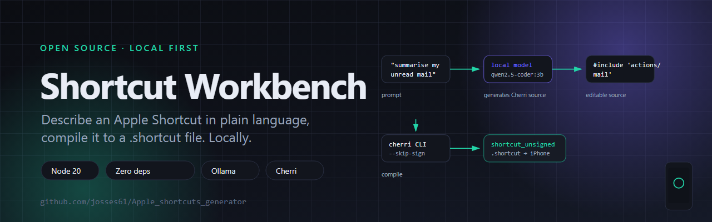

# Cherri Shortcut Workbench



A small web app for building Apple Shortcuts. Describe what you want the shortcut to do, let a
local model write the [Cherri](https://github.com/electrikmilk/cherri) source, then compile it
into a `.shortcut` file you can open on your iPhone, iPad or Mac.

The model runs on your machine — the app talks to a local [Ollama](https://ollama.com) instance by
default, with GitHub Models as an optional second provider. No code leaves your computer.

---

## Features

- **Prompt to shortcut** — describe the automation in plain language and get working Cherri
  source back, streamed into the editor as it is generated.
- **Edit the source directly** — the Cherri code is editable, and you can ask the model to revise
  it against what you already wrote.
- **Compile and download** — one click compiles the source with the Cherri CLI and hands you a
  `.shortcut` file.
- **Two model providers** — local Ollama (default) or GitHub Models, switchable from the UI.
- **Status you can see** — the app tells you whether Ollama is reachable, whether the model is
  pulled, and whether GitHub Models is configured.

### How Cherri fits in

Cherri is a plain-text language for Apple Shortcuts. The workbench writes Cherri source — with
`#include` directives for action groups, `const` constants, `@variable` shortcut variables and
brace-style control flow — and hands it to the `cherri` CLI to compile.

---

## Requirements

- **Node.js 20.12 or newer**
- **The Cherri compiler** on your `PATH` (or pointed at with `CHERRI_BIN`)
- **Ollama** with a coder model — optional if you use GitHub Models instead

The Cherri CLI is a separate tool. Install it first, or the compile step will tell you exactly
what is missing.

---

## Quick start

```bash
git clone https://github.com/josses61/Apple_shortcuts_generator.git
cd Apple_shortcuts_generator

cp .env.example .env
npm start
```

The app is then at <http://localhost:3000>. There are no npm dependencies to install — the server
uses only the Node standard library.

### Scripts

| Command | What it does |
|---|---|
| `npm start` | Starts the server, reading `.env` if present |
| `npm run dev` | Same, with file watching and auto-restart |

---

## Configuration

Everything is configured through environment variables. Copy `.env.example` to `.env` and edit it:

```ini
MODEL_PROVIDER=ollama
OLLAMA_BASE_URL=http://127.0.0.1:11434
OLLAMA_MODEL=qwen2.5-coder:3b
GITHUB_TOKEN=
GITHUB_MODEL=microsoft/Phi-4-mini-instruct
PORT=3000
CHERRI_BIN=/path/to/cherri
```

| Variable | Default | Meaning |
|---|---|---|
| `MODEL_PROVIDER` | `ollama` | `ollama` or `github` |
| `OLLAMA_BASE_URL` | `http://127.0.0.1:11434` | Where your Ollama service listens |
| `OLLAMA_MODEL` | `qwen2.5-coder:3b` | Model used for generation |
| `GITHUB_TOKEN` | _(empty)_ | GitHub token with Models read access; only needed for the `github` provider |
| `GITHUB_MODEL` | `microsoft/Phi-4-mini-instruct` | Model used for GitHub Models |
| `GITHUB_MODELS_URL` | GitHub inference endpoint | Override only if you use a different inference endpoint |
| `PORT` | `3000` | Port the app listens on |
| `CHERRI_BIN` | `cherri` | Path to the Cherri compiler when it is not on your `PATH` |

The `npm start` script uses Node's `--env-file-if-exists`, so `.env` is optional.

---

## API

The web app is a thin client over three endpoints:

```
GET  /api/status    compiler availability, model readiness, provider configuration
POST /api/generate  generate or revise Cherri source (server-sent events)
POST /api/compile   compile Cherri source, returns the .shortcut file
```

`/api/generate` streams, so the editor fills in as the model writes.

---

## Notes on the exported file

Compilation runs the Cherri CLI with `--skip-sign`, so the shortcut is exported **unsigned**. You
will need to sign it yourself — for example by opening the source in the Shortcuts app on macOS —
before running it on a device.

Compiler runs are capped at 60 seconds, and Cherri source over 120 KB is rejected before the
compiler is called.

---

## Project layout

```
Apple_shortcuts_generator/
├── server.js             the whole backend: API, providers, compiler call
├── public/
│   ├── index.html        app shell
│   ├── app.js            editor, generation and download logic
│   └── styles.css        UI styling
├── .env.example          every setting, documented
└── package.json
```

---

## Troubleshooting

**"The Cherri compiler is not installed"** — install the Cherri CLI, or set `CHERRI_BIN` to its
full path, then restart the app.

**"Could not reach the local Ollama service"** — start Ollama and check `OLLAMA_BASE_URL`.

**The model returns bad Cherri syntax** — try a larger coder model, or add the action groups you
need to the prompt; the app includes the correct `#include` lines in what it sends.

---

## Contributing

Pull requests are welcome. Provider-specific work belongs in `server.js`; keep the UI in
`public/app.js` talking only to the three API endpoints.

---

## License

No license file has been added yet. Ask before reusing the code.
